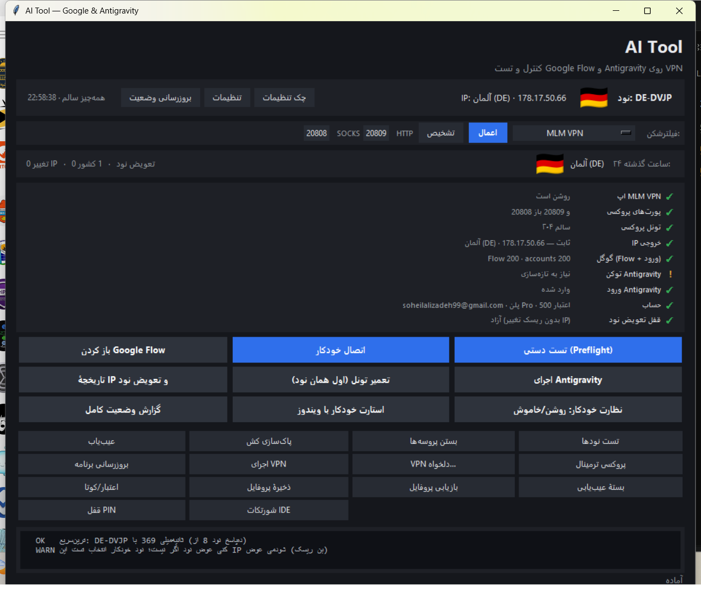
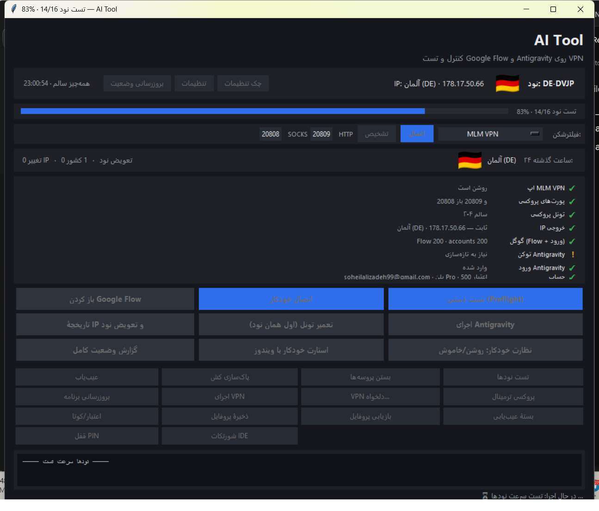

# ANTI G — AI Tool

<div dir="rtl">

**یک کنترل‌پنل فارسی و سبک برای ویندوز که Google Flow و Antigravity را از پشت فیلترشکن MLM VPN باز می‌کند، تونل را زیر نظر می‌گیرد و — مهم‌تر از همه — حواسش هست که IP عوض نشود.**

هر تعویض نود فیلترشکن یعنی یک IP جدید، و IP جدید یعنی ریسک بن شدن اکانت گوگل و آنتی‌گرویتی. این ابزار با همین قانون طراحی شده: **اول همان نود، بعد هم اگر لازم شد با قفل ۳۰ دقیقه‌ای.**



</div>

<div dir="rtl">

## فهرست

- [چه می‌کند](#چه-میکند)
- [عکس‌ها](#عکسها)
- [نصب](#نصب)
- [استفادهٔ روزمره](#استفادهٔ-روزمره)
- [به‌روزرسانی برنامه](#بهروزرسانی-برنامه)
- [پروفایل پشتیبان](#پروفایل-پشتیبان)
- [حریم خصوصی و امنیت](#حریم-خصوصی-و-امنیت)
- [ساخت از سورس](#ساخت-از-سورس)
- [انتشار نسخهٔ تازه (برای من)](#انتشار-نسخهٔ-تازه)
- [عیب‌یابی](#عیبیابی)
- [محدودیت‌ها](#محدودیتها)

## چه می‌کند

| قابلیت | توضیح |
|---|---|
| **اتصال خودکار** | اپ MLM را باز می‌کند، پنجره‌اش را جلو می‌آورد، همان نود قبلی را وصل می‌کند و عبور ترافیک را تست می‌کند |
| **قفل تغییر نود** | حداقل ۳۰ دقیقه بین دو تعویض نود؛ پیش‌فرض همیشه «همان نود» است |
| **انتخاب نود در اولین اتصال** | یک بار سریع‌ترین نود را انتخاب و ذخیره می‌کند، اسمش را در لاگ و نوتیف ویندوز می‌گوید و بعد دیگر دست نمی‌زند |
| **نوار پیشرفت واقعی** | درصد و مرحلهٔ جاری (بالا آمدن اپ، انتظار پورت، تست نود …) روی داشبورد و در نوار عنوان پنجره / نوار وظیفه |
| **بروزرسانی وضعیت** | با یک دکمه داشبورد تازه می‌شود، می‌گوید اتصال برقرار است یا نه و چه چیزی نسبت به بررسی قبل عوض شده (IP، نود، چک‌ها) |
| **هشدار خودکار قطعی** | هر ۶۰ ثانیه بررسی می‌کند؛ اگر تونل بخوابد نوتیف + نوار وضعیت قرمز، و با برگشتن اتصال خبر می‌دهد |
| **تاریخچهٔ IP** | هر تغییر IP و هر تعویض نود ثبت می‌شود؛ خلاصهٔ ۲۴ ساعت با پرچم کشورها بالای داشبورد |
| **تشخیص پورت** | اگر نسخهٔ فیلترشکن پورت دیگری بدهد، خودش پورت‌های واقعی پروکسی را پیدا و در تنظیمات ثبت می‌کند |
| **تست نودها** | سرعت TCP همهٔ نودها بدون وصل شدن و بدون تغییر IP |
| **وزن‌سنجی اتصال** | تست دستی Preflight (فقط خواندنی)، تعمیر تونل، گزارش وضعیت کامل |
| **اجرای Google Flow و Antigravity** | کروم/IDE با پروکسی درست، بدون دست‌کاری تنظیمات سیستم |
| **پروفایل پشتیبان** | خروجی/ورودی تنظیمات با یک فایل `.aitool-profile` (بدون توکن و بدون PIN) |
| **قفل PIN** | محافظت از تنظیمات حساس با هش PIN |
| **بستهٔ عیب‌یابی** | ZIP از وضعیت، لاگ‌ها و تنظیمات برای فرستادن به پشتیبانی |
| **اجرای VPN دلخواه** | پریست برای فیلترشکن‌های دیگر + پورت سفارشی |



## عکس‌ها

</div>

| داشبورد | نوار پیشرفت و مرحله در نوار وظیفه |
|---|---|
|  |  |

<div dir="rtl">

## نصب

۱. **فیلترشکن**: MLM VPN را نصب کن (این ریپو فیلترشکن را همراه ندارد؛ باید نسخهٔ رسمی خودت را داشته باشی) و یک بار بازش کن.

۲. **ابزار**: فایل `AI-Tool-Setup.exe` را از [Releases](../../releases/latest) بگیر و اجرا کن.
   - نصب per-user است و **نیاز به دسترسی مدیر ندارد**.
   - اگر SmartScreen آمد: **More info → Run anyway**.
   - مسیر نصب: `%LOCALAPPDATA%\AI Tool` — با شورتکات در Start Menu و دسکتاپ.

۳. **نودها**: این ریپو هیچ نود/اشتراکی را همراه ندارد. بعد از نصب، دکمهٔ **«بازیابی پروفایل»** → فایل `.aitool-profile` خودت را وارد کن (یا داخل خود MLM یک نود انتخاب کن).

> نسخهٔ portable هم هست: `AI-Tool-portable.zip` را باز کن و `AI-Tool-GUI.bat` را اجرا کن (پایتون لازم دارد).

## استفادهٔ روزمره

- **اتصال خودکار** — هر روز همین یک دکمه. دکمه خودش حالت «در حال انجام» می‌گیرد، نوار پیشرفت درصد واقعی می‌دهد و در آخر می‌گوید با کدام نود و کدام IP وصل شدی.
- **باز کردن Google Flow / اجرای Antigravity** — با پروکسی درست و همان نود.
- **بروزرسانی وضعیت** — هر وقت خواستی بدانی همه‌چیز سر جایش است یا نه؛ تفاوت‌ها را هم می‌گوید.
- **تعمیر تونل** — اگر تونل مرد، اول همان نود را دوباره وصل می‌کند؛ فقط اگر نشد و قفل ۳۰ دقیقه اجازه داد، نود را عوض می‌کند.
- **نظارت خودکار** — نگهبانی که هر ۱۲۰ ثانیه تونل را تست می‌کند (دکمهٔ روشن/خاموش دارد و با ویندوز هم بالا می‌آید).

## به‌روزرسانی برنامه

دکمهٔ **«بروزرسانی برنامه»** در بخش ابزارها (ریپو: [soheilme/anti-g](https://github.com/soheilme/anti-g)):

1. نسخهٔ منتشرشده را از GitHub می‌خواند (`[update] repo` در `agtool.ini`).
2. اگر نسخهٔ تازه باشد، `AI-Tool-Setup.exe` همان Release را دانلود می‌کند (با درصد پیشرفت).
3. نصب‌کننده را اجرا می‌کند؛ بعد از نصب برنامه را دوباره باز کن.

از خط فرمان هم می‌شود:

</div>

```bat
AI-Tool.exe update            :: فقط بررسی
AI-Tool.exe update install    :: بررسی + دانلود + اجرای نصب
```

<div dir="rtl">

تنظیمات مربوطه در `agtool.ini`:

</div>

```ini
[update]
version = 1.1.0
repo = soheilme/anti-g
feed_url =
```

<div dir="rtl">

## پروفایل پشتیبان

- **ذخیرهٔ پروفایل** — یک فایل JSON با تنظیمات، فهرست نودها، پریست‌ها و وضعیت (بدون توکن، بدون PIN).
- **بازیابی پروفایل** — تنظیمات را برمی‌گرداند.
- پروفایل «بدون نود/IP» برای فرستادن به بقیه: نود و IP ماشین مقصد را پاک می‌کند تا هر کس IP خودش را داشته باشد.

## حریم خصوصی و امنیت

**چه چیزی در این ریپو/ریلیز عمومی نیست:**

| مورد | وضعیت |
|---|---|
| نودهای فیلترشکن و UUID اشتراک (`vless://…@host`) | ❌ منتشر نمی‌شود؛ فایل نمونه فقط `[]` دارد |
| `agtool.ini` (شامل `client_id` / `client_secret` و مسیرهای محلی) | ❌ از گیت خارج است؛ فقط `agtool.example.ini` منتشر شده |
| توکن/refresh token آنتی‌گرویتی | ❌ هرگز خوانده-و-ارسال نمی‌شود؛ حتی در پروفایل هم نیست |
| پروفایل‌های `.aitool-profile` | ❌ منتشر نشده‌اند (نودها را درون خود دارند) |
| تاریخچهٔ IP و وضعیت (`agtool-state.json`) | ❌ فقط محلی است |
| حساب گوگل، ایمیل، اعتبار/پلن | ❌ در هیچ فایلی نیست |

**در برنامه:**

- توکن Antigravity فقط **خوانده** می‌شود (برای نمایش اعتبار)؛ هیچ‌جا آپلود نمی‌شود و در پروفایل هم نیست.
- PIN به صورت هش نگه داشته می‌شود، نه متن ساده.
- هیچ تله‌متری، آنالیتیکس یا سرور وسط وجود ندارد؛ تنها تماس اینترنتی، بررسی نسخه از GitHub است.
- تنظیمات و تاریخچه محلی‌اند: `agtool.ini` و `agtool-state.json` (هر دو در `.gitignore`).

> ⚠️ پروفایل `.aitool-profile` را هیچ‌وقت در گیت، دیسکورد یا تلگرام عمومی نگذار: فهرست نودها با UUID اشتراکت داخلش است. برای فرستادن به دوست، فقط به‌صورت خصوصی بفرست.

## ساخت از سورس

نیازمندی: Windows 10/11، Python 3.10+، .NET Framework 4 (برای نصب‌کننده).

برای خوانا بودن خروجی فارسی در ترمینال (خطوط راست‌چین و غیربرعکس دیده شوند) دو پکیج کوچک لازم است:

</div>

```bat
pip install arabic-reshaper python-bidi
```

<div dir="rtl">

اگر نصب نباشند برنامه کار می‌کند و فقط چینش خطوط ترمینال اصلاح نمی‌شود. برای خاموش کردن این قابلیت: `set AGT_RTL=0` (و برای تعیین دستی عرض: `set AGT_RTL_WIDTH=100`).

اول تنظیمات را از نمونه بساز (فایل `agtool.ini` در گیت نیست):

</div>

```bat
copy agtool.example.ini agtool.ini
```

<div dir="rtl">

مقادیر `client_id` و `client_secret` بخش `[antigravity]` را از نصب خود IDE بردار یا در متغیر محیطی `AG_CLIENT_SECRET` بگذار؛ بدون آن‌ها فقط توکن موجود استفاده می‌شود و تازه‌سازی خودکار انجام نمی‌شود.


</div>

```bat
pip install pyinstaller
python -m PyInstaller --noconfirm --onefile --windowed --name AI-Tool ^
  --icon agtool.ico --add-data "mlm_found_nodes.json;." --add-data "README.txt;." agtool.py

powershell -NoProfile -Command "& 'C:\Windows\Microsoft.NET\Framework64\v4.0.30319\csc.exe' '@installer\build.rsp'"
```

<div dir="rtl">

خروجی‌ها: `dist\AI-Tool.exe` و `AI-Tool-Setup.exe`.

## انتشار نسخهٔ تازه

برای اینکه دکمهٔ به‌روزرسانی برای همه کار کند، هر نسخه باید این سه قدم را داشته باشد:

۱. شمارهٔ نسخه را در `agtool.ini` (بخش `[update]` → `version`) بالا ببر.
۲. بیلد بگیر (`AI-Tool-Setup.exe`).
۳. در GitHub یک **Release** با تگ `vX.Y.Z` بساز و فایل `AI-Tool-Setup.exe` را ضمیمه کن.

یا همهٔ این‌ها را با یک دستور انجام بده (نسخه و ریپو را از `agtool.ini` می‌خواند):

</div>

```bat
python tools\publish_release.py
```

<div dir="rtl">

> اگر پشت پروکسی هستی، اسکریپت هدر `Expect` را خاموش می‌کند؛ بدون این کار آپلود فایل بزرگ روی بعضی پروکسی‌ها نیمه‌کاره می‌ماند.


برنامه نسخهٔ `tag_name` را می‌خواند و اولین فایل `.exe` ضمیمه‌شده را دانلود می‌کند.

## عیب‌یابی

| نشانه | معنی و راه‌حل |
|---|---|
| «پورت‌های پروکسی بسته‌اند» | MLM خودش وصل نشده؛ پنجرهٔ MLM را باز کن و یک نود را وصل کن، بعد «اتصال خودکار» |
| «API اپ VPN جواب نمی‌دهد» | اپ باز است ولی موتور اتصالش بالا نیامده؛ اپ را کامل ببند و باز کن |
| «اکانت/حجم/پلن MLM» | مشکل از اشتراک فیلترشکن است، نه ابزار |
| «قفل تعویض نود» | محافظت عمدی است؛ ۳۰ دقیقه صبر کن یا `heal force` بزن (IP عوض می‌شود) |
| چیزی عجیب است | دکمهٔ **«بستهٔ عیب‌یابی»** → یک ZIP روی دسکتاپ می‌سازد |

## محدودیت‌ها

- فقط ویندوز (Tkinter + PowerShell + API محلی MLM).
- کنترل نود از راه API محلی MLM انجام می‌شود؛ اگر خودت داخل MLM نود عوض کنی، ابزار نمی‌تواند اسم نود جدید را بخواند و فقط IP جدید را ثبت می‌کند.
- نسخهٔ MLM و پورت‌هایش ممکن است عوض شود؛ دکمهٔ «تشخیص» و تشخیص خودکار پورت برای همین است.
- این پروژه فیلترشکن نیست و هیچ اشتراک/سروری نمی‌فروشد.

## سلب مسئولیت

ابزار فقط تنظیمات و بررسی‌های محلی انجام می‌دهد. استفاده از VPN و سرویس‌های شخص ثالث تابع قوانین و شرایط خودشان است و مسئولیت آن با کاربر است. نویسندگان هیچ ضمانتی برای جلوگیری از بن شدن اکانت یا قطعی سرویس نمی‌دهند.

مجوز: [MIT](LICENSE)

</div>
